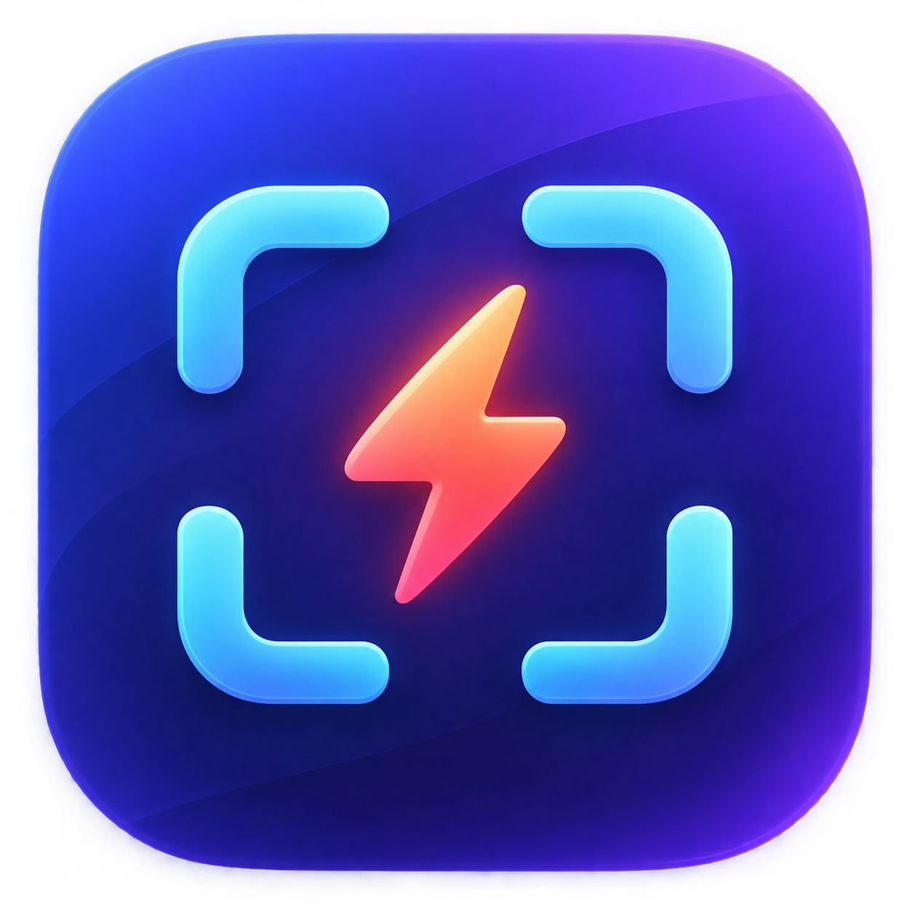

<p align="center">
  
</p>

# VibeShot

**Capture the moment. Mark what matters. Get back to work.**

VibeShot is a native macOS menu-bar screenshot and annotation app. Click the icon, select a region, annotate it over your desktop, then copy, save, print, or share the result. There is no persistent main window to manage.


## From screenshot to something worth sharing

- **Start where your pointer is.** Left-click for region capture; right-click for commands and settings. Global shortcuts and per-display full-screen capture are available.
- **Annotate in place.** Pen, line, arrow, rectangle, marker, and text, with color/width controls and Undo / Redo.
- **Adjust the crop.** Move and resize the selected region, inspect native-pixel dimensions, or select the whole display.
- **Finish your way.** Copy to clipboard; save PNG, JPEG, HEIC, or BMP; print; or use the native macOS share picker.
- **Keep your workflow close.** Recent save folders, configurable settings, Launch at Login, and opt-in Remember Last Region.
- **Keep captures local.** Screenshot pixels and annotations stay in memory until you explicitly copy, save, print, or share. The app has no built-in cloud upload or account requirement.

The selection and editing workflow is inspired by Lightshot, with an independent native implementation. Screen Recording permission is required for capture.

## Build and try it

Requires **macOS 14+** and **Xcode with Swift 6 support**. The project is currently developed with Xcode 27.

```sh
git clone https://github.com/hiepkhach1005/VibeShot.git
cd VibeShot
open VibeShot.xcodeproj
```

Select the **VibeShot** scheme and Run. Grant Screen Recording permission when requested, following the app's permission guidance. The committed Xcode project is the canonical app build.

## Local validation

```sh
# Fast compiler and unit-test feedback
swift build
swift test

# Unsigned Debug tests and Debug/Release Xcode builds
./scripts/validate.sh
```

The script selects `/Applications/Xcode.app` by default; set `DEVELOPER_DIR` for another installation. The Swift package provides a fast validation path. UI tests require a separately signed runner and are skipped by the unsigned script.

## Development status

Capture, annotations, export, and lifecycle/release scaffolding are implemented. Signed hardware checks, multi-display/Retina acceptance, capture-start animation investigation, and distribution signing/notarization remain tracked work. This repository is a **development preview**, not a notarized release.

See [current progress](docs/PROGRESS.md), the [test matrix](docs/TESTING.md), and the [release runbook](docs/RELEASING.md). The original snapshot remains immutable while annotations are edited; export composites the selected region and committed annotations.

## Explore or contribute

Start with the [product specification](docs/PRODUCT_SPEC.md), [architecture](docs/ARCHITECTURE.md), and [project map](docs/PROJECT_MAP.md). [Open an issue](https://github.com/hiepkhach1005/VibeShot/issues) with your macOS version, display setup, and steps to reproduce. Use synthetic images or redact private content in any example capture.
